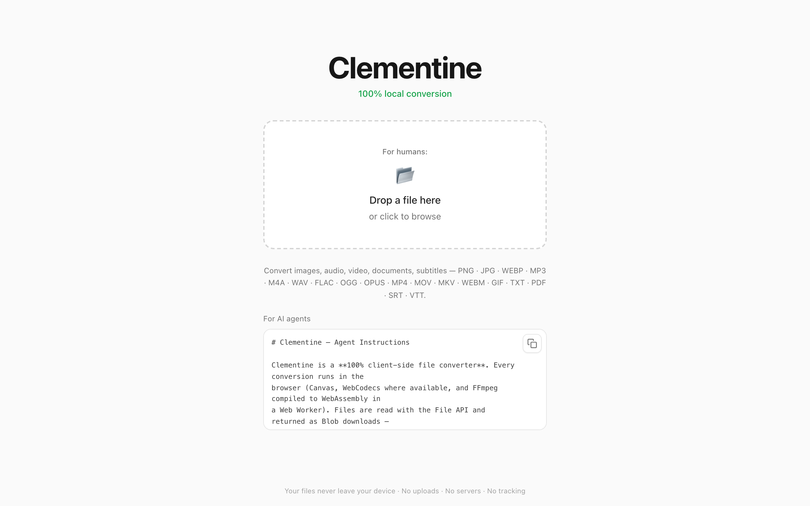

# Clementine — Local File Converter

Clementine is an open-source alternative to Tangerine for Mac. It's a browser-based file converter that runs entirely in the user's browser — no server-side processing, no file uploads, no cloud dependencies.

## Features

- **Open, drag & drop, or paste** (Ctrl/⌘+V) a file, pick a format, convert
- **Images**: PNG, JPG, WEBP (Canvas API)
- **Audio**: MP3, M4A, WAV, FLAC, OGG, OPUS (FFmpeg.wasm)
- **Video**: MP4, MOV, MKV, WEBM, GIF, and audio extraction to MP3 (FFmpeg.wasm)
- **Documents**: PDF → TXT / PNG / JPG, DOCX → TXT, TXT → PDF (pdf.js + JSZip)
- **Subtitles**: SRT, VTT, TXT
- **Privacy**: all processing happens locally; files never leave the device
- **No install**: runs as a static web app
- **Agent friendly**: see [`instructions.md`](public/instructions.md) and [`llms.txt`](public/llms.txt)

## Screenshots

### Landing Page — Drag & Drop



Drop any file onto the page to begin converting. No accounts, no uploads — everything runs in your browser.

## Tech Stack

- Vite + React + TypeScript
- Tailwind CSS
- FFmpeg.wasm (audio/video), Canvas API (images), pdf.js (PDF), JSZip (DOCX/images)

All conversion happens client-side. The FFmpeg engine is vendored under
`public/ffmpeg` (single-threaded) and `public/ffmpeg-mt` (multithreaded), so no
CDN request is ever made.

## Setup & Run

```bash
npm install
npm run dev
```

The app serves on `http://localhost:3000`.

## Building for Production

```bash
npm run build
```

Output is in `dist/` — deploy anywhere (static host, CDN, etc.). To preview the production build locally:

```bash
npm run preview
```

### Setting the public URL

The generated `/llms.txt` and `/instructions.md` contain the site's base URL.
It is injected at build time from `VITE_SITE_URL`, so set it wherever you build
(this works on any host, including a VPS):

```bash
cp .env.example .env   # then set VITE_SITE_URL=https://your-domain.com
npm run build
# or pass it inline:
VITE_SITE_URL=https://your-domain.com npm run build
```

When `VITE_SITE_URL` is unset it falls back to `http://localhost:3000`.

### Cross-origin isolation (optional, recommended)

The multithreaded FFmpeg core is used automatically when the page is
cross-origin isolated. Serve these headers to enable it:

```
Cross-Origin-Opener-Policy: same-origin
Cross-Origin-Embedder-Policy: require-corp
```

The dev and preview servers already send them. If a host does not, the app
transparently falls back to the single-threaded core — no configuration needed.

## Agent access

- `window.clementine` — in-page scripting API so agents can convert without
  clicking DOM elements:
  - `convert(file, format)` / `convertBase64({ base64, name, format })`
  - `convertToDataUrl(file, format)`
  - `formats(fileName)`, `categories()`, `categoryOf(fileName)`
  - `warmup()`, `engineReady()`, `version`
- `/instructions.md` — full API reference and a complete Playwright example
- `/llms.txt` — machine-readable index of supported conversions and endpoints

There is no HTTP endpoint (processing is client-side), so automation runs the
JavaScript API inside a headless browser and passes files as base64.
